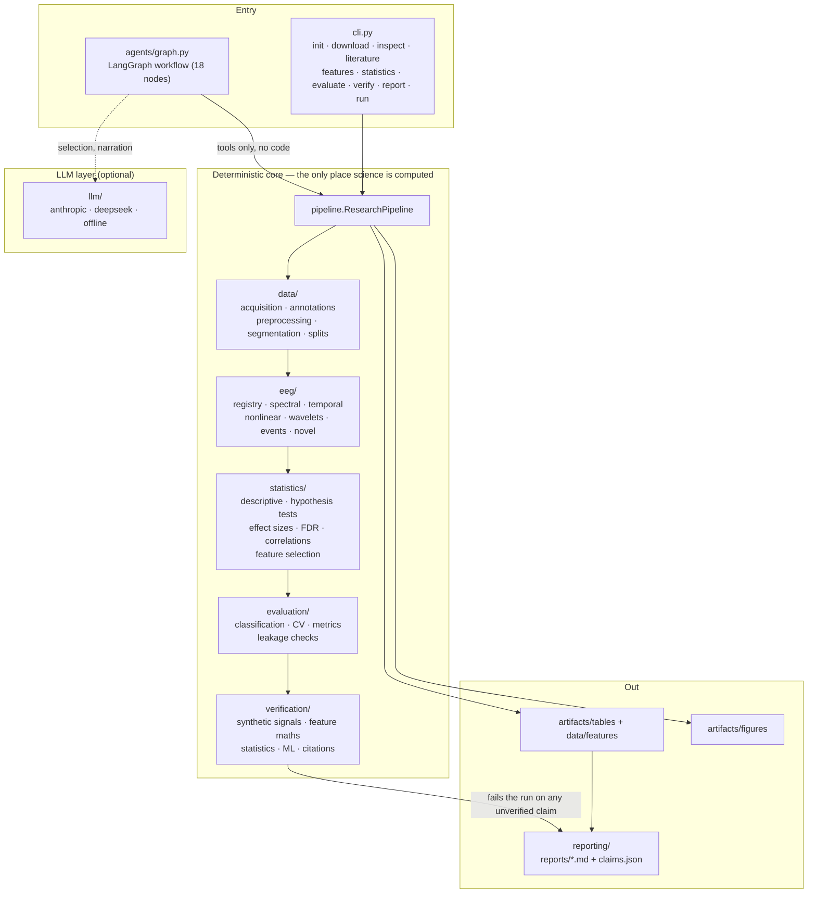

# agentic-feature-exploration

**An autonomous research platform for single-channel EEG feature discovery in
sleep staging — literature review, feature engineering, statistics, prediction
and adversarial verification, with a hard boundary between LLM reasoning and
deterministic computation.**

---

## Why this exists

Sleep staging from a *single* EEG derivation is an intentionally hard problem.
N1 is a transition state with weak EEG signatures; N2 depends on spindles and
K-complexes that are absent from many 30 s epochs; REM often looks like light
sleep on EEG alone and is normally separated using EOG and EMG that we do not
have.  A classifier can score well on such data for the wrong reason — by
memorising the subject.

This project asks a narrower, more defensible question:

> Which single-channel EEG characteristics are associated with sleep stages, and
> which of them improve stage prediction on subjects the model has never seen?

and it answers that question with an auditable pipeline rather than a notebook.
Everything from dataset acquisition to the final report is scripted, seeded,
tested and reproducible.

## The one design rule

**The LLM never computes a number.**

An LLM may choose which *registered* analysis to prioritise, interpret saved
results and write prose.  It cannot execute code, and it cannot introduce a value
that has no artifact behind it.  Every figure, table and sentence in the reports
traces back to a saved result file, and every reported number is registered as a
claim and re-read from disk by the verification stage.

That is why this is built as a **LangGraph workflow** over a deterministic
pipeline, and not as a chain of prompts: see
[docs/agent_workflow.md](docs/agent_workflow.md#why-a-graph-at-all).

## Architecture



Full detail: [docs/architecture.md](docs/architecture.md).

## What it actually produces

Reference run (`--mode standard`, synthetic surrogate, no network):

| Stage | Result |
| --- | --- |
| Corpus | 6 subjects, 720 epochs, 30 s each, one derivation (`EEG Fpz-Cz`) |
| Feature catalog | **107 registered features** — 32 spectral, 19 temporal, 7 nonlinear, 13 wavelet, 17 event-based, 7 literature-derived, 12 novel |
| Statistics | 109 analysed columns, **103 significant after FDR** at α = 0.05 |
| Prediction | best held-out model: `top_k_mutual_information` + SVM, balanced accuracy 0.811, macro F1 0.730, Cohen's κ 0.778 |
| Verification | **83 checks, 0 failures**, 21/21 reported numbers re-verified against their artifacts |
| Reports | 5 Markdown reports + `claims.json` evidence trail |

Numbers above are regenerated by `cli run`; the committed reports in
[`reports/`](reports/) are the artifacts of that run.

> **Provenance caveat.** This build ran **offline**. Sleep-EDF could not be
> downloaded, so the pipeline used its deterministic synthetic PSG surrogate and
> tagged every artifact `data_origin: synthetic`. Those results validate the
> *machinery*; they are not statements about human sleep. Re-run with network
> access to use the real dataset — the code path is the same.

## Install

```bash
git clone <this repo> && cd agentic-feature-exploration

conda env create -f environment.yml
conda activate eeg-research-agent
python -m pip install -e .
```

Verify:

```bash
python -m eeg_research_agent.cli tools      # tool permission table
python -m eeg_research_agent.cli run --mode smoke
```

### Environment status (read this)

* Target: **Python 3.14**.  Executed: **Python 3.13.5**.
  The 3.14 interpreter builds fine, but no `cp314` wheels for
  numpy/scipy/scikit-learn/pandas/matplotlib exist and the sandbox has no
  package-index access, so the scientific stack cannot be installed for it.
  Flipping to 3.14 is a one-line change in `environment.yml` once wheels exist.
  Full evidence and the list of packages that had to be worked around (no
  `pyarrow`, no `statsmodels`, no `PyWavelets`, no `ruff`/`mypy`) is in
  [docs/environment_notes.md](docs/environment_notes.md).
* **No network was available**, so the run used the synthetic surrogate and
  offline literature mode. Nothing in the pipeline requires network or an API key.

## API keys (optional)

The whole deterministic pipeline runs with **zero credentials**.  An LLM key is
only needed for live literature reasoning and richer narration.

```bash
cp .env.example .env
export LLM_PROVIDER=anthropic        # or: deepseek | offline
python -m eeg_research_agent.cli llm-check --provider anthropic
```

`llm-check` prompts for the key with hidden input, writes it to `.env` with
owner-only permissions (mode 600), and never echoes it.  The requested model id
is verified against the provider's model list — an unknown id is a hard error,
never a silent downgrade.  `.env` is git-ignored; keys are redacted in logs and
`repr`.

## Running the pipeline

```bash
# the complete workflow, one command
python -m eeg_research_agent.cli run                      # deterministic
python -m eeg_research_agent.cli run --agentic            # through LangGraph

# individual stages
python -m eeg_research_agent.cli download                 # Sleep-EDF, or synthetic fallback
python -m eeg_research_agent.cli inspect                  # channels, annotations, class balance
python -m eeg_research_agent.cli literature               # bibliography (offline-safe)
python -m eeg_research_agent.cli features                 # preprocess → epoch → extract
python -m eeg_research_agent.cli statistics               # tests, effect sizes, FDR
python -m eeg_research_agent.cli evaluate                 # subject-grouped prediction
python -m eeg_research_agent.cli verify                   # synthetic/statistical/ML/citation checks
python -m eeg_research_agent.cli report                   # regenerate reports from artifacts
```

Useful options (accepted before *or* after the subcommand):
`--mode smoke|standard|full`, `--origin sleep_edf|synthetic_psg|auto`,
`--seed`, `--max-subjects`, `--channel`, `--papers`, `--no-cache`, `--offline`.

`make test`, `make run`, `make report`, `make clean` wrap the common cases.

## Feature engineering

107 registered features, each with a formula, units, required sampling rate,
computational cost, validation status and novelty status.  Definitions and
reasoning: [docs/mathematical_features.md](docs/mathematical_features.md);
generated catalog: [reports/feature_catalog.md](reports/feature_catalog.md).

* **Spectral** — absolute/relative band power (Welch, 4 s windows), log power,
  ratios, centroid, spread, entropy, flatness, edge frequency, roll-off,
  skewness, kurtosis, flux.
* **Temporal** — moments, RMS, peak-to-peak, zero-crossing rate, line length,
  Hjorth activity/mobility/complexity.
* **Nonlinear** — sample/approximate/permutation entropy, Higuchi and Petrosian
  fractal dimension, DFA α1/α2.
* **Wavelet** — hand-written Daubechies-4 DWT (verified by perfect
  reconstruction), per-level energy and ratio, energy entropy and slope.
* **Event-based** — spindle, K-complex and slow-wave detectors with explicit,
  documented thresholds.  *Sigma power is not spindle density*, and both are kept.
* **Novel hypotheses** — spectral concentration `C_α`, within-epoch spectral
  instability, cross-band entropy imbalance, multiscale energy entropy, and
  inter-epoch transition norms.  Every one is labelled *hypothesis, not a
  validated finding*.

Each feature is unit-tested against synthetic signals whose answer is known by
construction (a pure tone must peak at its own frequency; scaling the amplitude
must scale absolute power quadratically and leave relative power unchanged;
white noise must be flatter than a tone).

## Statistical analysis

* **Unit of analysis is the subject.**  Epochs within a subject are not
  independent, so the primary analysis runs on subject × stage means
  (Friedman + paired Wilcoxon when the design allows, otherwise Kruskal-Wallis /
  Welch ANOVA + Dunn).  The epoch-level test is reported but explicitly flagged
  as pseudo-replicated.
* **Assumptions first.**  D'Agostino-Pearson/Shapiro-Wilk for normality, Levene
  for variance homogeneity, then a fixed decision table picks the test.
* **Effect sizes always.**  Hedges' g, rank-biserial, Cliff's delta,
  eta-squared, epsilon-squared, Kendall's W, with subject-bootstrap CIs.
* **Multiple testing.**  Benjamini-Hochberg FDR by default (Holm and Bonferroni
  available); raw *and* adjusted p-values are stored, with the family size.
* **Order-free association.**  Multiclass sleep labels are never treated as a
  continuous variable: Kruskal epsilon-squared, mutual information, and
  point-biserial only for genuine two-group splits.

Methodology and its limitations: [docs/statistical_methodology.md](docs/statistical_methodology.md).

## No data leakage, by construction

* Splits are by **subject**, with a saved manifest and a verifier that fails the
  run if any subject appears under two split labels.
* Feature selection, imputation and scaling see **training rows only**; the
  audit re-reads the selection report and checks `n_train_rows` against the
  table size.
* Non-causal inter-epoch features are detected and excluded from causal
  ablations; smuggling one back in fails the leakage audit.
* The test set is read once, at the end.
* `tests/test_splits.py` includes a negative control: a random *epoch-level*
  split is detected as leaking.

## Verification

The verification stage attacks the result instead of restating it — 83 checks,
0 failures in the reference run:

| Section | Checks | Examples |
| --- | --- | --- |
| Synthetic signals | 33 | a 10 Hz tone peaks at 10 ± 1 Hz; white noise is flatter than a tone; amplitude scaling behaves quadratically |
| Feature mathematics | 15 | DWT perfect reconstruction (< 1e-9); entropy bounds; invariance properties |
| Statistics | 23 | Monte-Carlo type-I error ≈ α; agreement with SciPy; BH vs closed form |
| Machine learning | 4 | subject separation, reproducible predictions, baseline comparison |
| Leakage | 4 | split integrity, duplicate rows, selection scope, non-causal exclusion |
| Evidence | 4 | every reported number re-read from its artifact; every citation validated |

Remote sources that cannot be reached are **reported**, never fabricated:
offline records carry `evidence_level: unverified-offline` and are listed as
unverified rather than certified.

## Repository layout

```
config/          settings.yaml · dataset.yaml · features.yaml · analysis.yaml
data/            raw · interim · processed · features · metadata   (git-ignored contents)
src/eeg_research_agent/
  agents/        state · nodes · graph · tools · prompts      (LangGraph)
  data/          acquisition · inspection · preprocessing · annotations · splits · synthetic
  eeg/           registry · spectral · temporal · nonlinear · wavelets · sleep_events
                 · novel_features · feature_extraction · segmentation
  statistics/    descriptive · hypothesis_tests · effect_sizes · multiple_testing
                 · correlations · feature_selection · engine
  evaluation/    classification · cross_validation · metrics · leakage_checks
  verification/  synthetic_signals · feature_validation · statistical_validation
                 · research_validation
  reporting/     context · plots · literature_report · feature_catalog
                 · statistical_report · validation_report · final_report
  llm/           provider · offline
  cli.py · pipeline.py · config.py · paths.py · logging_utils.py
tests/           8 modules, 70 tests (offline, no API key)
docs/            architecture · mathematical_features · statistical_methodology
                 · agent_workflow · environment_notes
reports/         literature_review · feature_catalog · statistical_analysis
                 · validation_report · final_research_report
artifacts/       figures · tables · execution_logs
```

## Limitations

* **Single channel.** EOG/EMG information that normally separates REM is absent;
  REM and N1 are expected to remain the hardest stages.
* **This run is synthetic.** All numbers here describe the surrogate generator.
* **No mixed-effects models.** `statsmodels` was unavailable; subject
  aggregation plus Friedman/cluster permutation is the substitute.
* **Heuristic event detectors.** Spindle/K-complex/slow-wave thresholds are
  parameterised and behaviour-tested, not validated against expert annotations.
* **Novel features are hypotheses.** They are reported with their novelty status
  everywhere and are not claimed as discoveries.
* **Offline bibliography.** 4 anchor sources at `unverified-offline`; no live
  retrieval in this build.
* **No log-linear models / no deep learning.** Deep architectures such as
  AttnSleep and BIOT are out of scope for this milestone; the feature table is
  deliberately shaped to feed them later.

## Future work

* Run against real Sleep-EDF (and SHHS) with network access; re-run the
  literature agent against Semantic Scholar/OpenAlex/PubMed.
* Compare the interpretable feature stack against AttnSleep and BIOT
  representations, including feature-level fusion and probing of learned
  embeddings.
* Replace subject aggregation with mixed-effects models once `statsmodels` is
  available.
* Validate spindle/K-complex detectors against expert-scored event annotations.
* Cross-dataset transfer and per-site domain adaptation.

## License

MIT — see [LICENSE](LICENSE).
