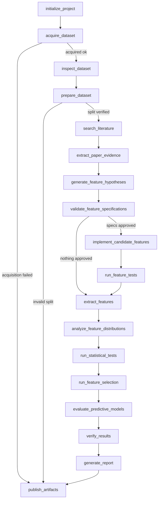

# Agent workflow (LangGraph)

## Why a graph at all

A script that calls an LLM five times in a row would be simpler to write and
worse to run.  The workflow here needs four things a prompt loop cannot give:

1. **State that survives a failure.**  Acquisition, feature extraction and the
   statistical machinery are expensive.  State is checkpointed, so a run can be
   re-entered instead of restarted.
2. **Explicit, inspectable routing.**  A failed acquisition, an invalid subject
   split, and an empty approved-feature set each take a *different* path.  That
   logic is a named function returning a node name, not a `try/except` buried in
   a prompt.
3. **Bounded responsibilities.**  Each node has one job and a permission-limited
   tool set, so "the agent" cannot quietly do something else.
4. **A hard boundary between narration and computation.**  Nodes call
   `ResearchPipeline` — the same functions the CLI calls.  There is no second,
   agentic implementation of the science.

Repeated LLM calls give you a transcript.  A graph gives you a *workflow with
named failure modes*.

## State

`agents/state.py` defines `ResearchState`, a typed Pydantic model holding only
identifiers, summaries and artifact paths — never a computed value that cannot be
re-derived from an artifact.  `stages_completed` and `errors` are
`Annotated[list[str], operator.add]`, so parallel or retried branches accumulate
rather than overwrite.

`jsonable()` normalises node output into msgpack/JSON primitives at the single
boundary where state enters the graph (LangGraph's checkpointer rejects numpy
scalars; the conversion happens once, in the decorator, instead of in every node).

## Nodes (18)

| # | Node | Role | Does |
| --- | --- | --- | --- |
| 1 | `initialize_project` | dataset | Directories, event log, execution manifest. |
| 2 | `acquire_dataset` | dataset | Sleep-EDF or the synthetic surrogate. |
| 3 | `inspect_dataset` | dataset | Channel/annotation/quality/class-balance summary; LLM narrates it. |
| 4 | `prepare_dataset` | dataset | Preprocess → epoch → subject split. |
| 5 | `search_literature` | literature | Provider search, offline-safe. |
| 6 | `extract_paper_evidence` | literature | Structured evidence per record; citation validation. |
| 7 | `generate_feature_hypotheses` | feature | LLM *selects* from registry-generated candidates. |
| 8 | `validate_feature_specifications` | feature | Rejects anything not in the registry with declared parameters. |
| 9 | `implement_candidate_features` | feature | Attaches approved ids to the extraction config. |
| 10 | `run_feature_tests` | verification | Unit/behaviour checks on the approved set. |
| 11 | `extract_features` | feature | Deterministic extraction over the epoch set. |
| 12 | `analyze_feature_distributions` | statistics | Descriptive summaries. |
| 13 | `run_statistical_tests` | statistics | Assumption checks, tests, FDR. |
| 14 | `run_feature_selection` | statistics | Training-rows-only ranking and redundancy control. |
| 15 | `evaluate_predictive_models` | statistics | Subject-grouped held-out evaluation. |
| 16 | `verify_results` | verification | Synthetic, statistical, ML, leakage and citation checks. |
| 17 | `generate_report` | reporting | Markdown reports + `claims.json`. |
| 18 | `publish_artifacts` | reporting | Writes the graph trace locally; never pushes anywhere. |

## Conditional edges



Three routers implement this:

* `route_after_acquire` — a dataset that was not obtained cannot be inspected.
* `route_after_split` — a split that does not partition subjects invalidates
  every later metric, so the run skips straight to publishing what it has.
* `route_after_validation` — with no approved specification there is nothing to
  implement or test.

A node that raises is caught by the `_node` decorator: the error is appended to
`state.errors`, the stage is recorded as failed in `execution_metadata`, and the
run is never reported as successful.

## Tools and permissions

Agents call tools; agents never write executable code.  `agents/tools.py` holds
`AGENT_TOOLS`, a table mapping each tool to its callable and the roles allowed to
use it:

```
dataset      → inspect_recording, get_channel_metadata
feature      → calculate_band_power, detect_spindles
statistics   → describe_feature_distribution, correct_multiple_tests,
               calculate_effect_size
verification → generate_synthetic_signal, verify_split_integrity,
               check_data_leakage, validate_citations,
               validate_statistical_results, correct_multiple_tests
literature   → search_papers, retrieve_open_access_text,
               extract_paper_evidence, validate_citations
reporting    → create_feature_catalog, generate_final_report
```

`ResearchToolbox` is the facade; `toolbox.for_role("statistics")` returns a view
restricted to that role, and calling a tool the role does not own raises
`ToolNotPermitted`.  Role-scoped views share the parent's call log, so the graph
trace records every tool call.

## What the LLM is allowed to do

Exactly four tasks, all of which are *selection, interpretation or prose*:

| Task | Input it may see | It cannot |
| --- | --- | --- |
| `dataset_summary` | The JSON dataset summary | Invent channels, stages or counts |
| `search_topics` | The research question | Invent citations |
| `feature_hypotheses` | The registry's candidate ids | Propose executable code, or add a feature that is not registered |
| `interpretation` / `report_section` | Saved result summaries | Invent a numerical result |

`FeatureRegistry.validate_specification()` is the only place LLM output crosses
into the pipeline: it accepts registered ids with declared parameters and
sampling-rate/sample-length checks, and rejects everything else with a recorded
reason.  If the provider is unreachable, the node logs a warning and continues —
the deterministic pipeline never depends on LLM availability.

## Providers

`LLM_PROVIDER=anthropic | deepseek | offline`.  The model id is verified against
the provider's model list; an unknown id raises `ModelNotAvailableError` rather
than silently substituting a different model.  Keys are read from the
environment or `.env` and redacted in `repr`.  `offline` is the default
provider and needs no credentials.

## Running it

```bash
python -m eeg_research_agent.cli run --agentic --mode smoke
```

The summary printed at the end contains `errors`, `stages_completed`,
`n_features_approved`/`n_features_rejected`, `verification_ok`, `llm_calls` and
`tools`.  The full trace is written to
`artifacts/execution_logs/graph_run.json`.
